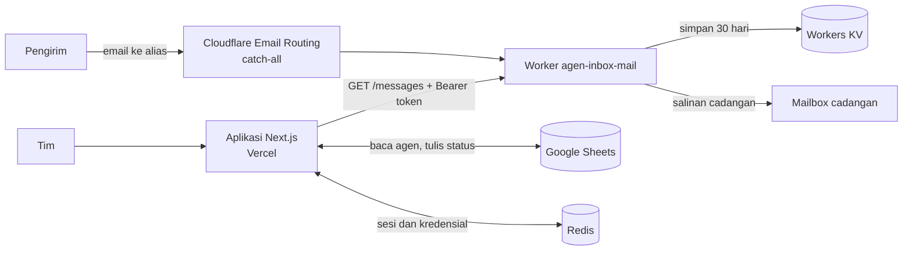

<div align="center">


# Agen Inbox

**Satu inbox untuk setiap alias agen.**

Baca email per alias, buka tautan aktivasi secara manual, lalu catat **BERHASIL** atau **GAGAL** langsung ke Google Sheets.


</div>

---

## Fitur

- **Inbox per alias**: setiap agen punya alias di domain kustom, dan email masuknya tampil per agen.
- **Sinkron Google Sheets**: daftar agen dan status dibaca langsung dari spreadsheet. Menyimpan status hanya menulis satu sel.
- **Preview email aman**: HTML disanitasi lalu ditampilkan di iframe tanpa skrip (CSP `script-src 'none'`). Gambar dan font eksternal diblokir, dan tinggi preview mengikuti isi email.
- **Tautan terkendali**: hanya tautan HTTPS ke domain LinkUMKM yang diizinkan yang bisa dibuka, dan selalu dibuka manual.
- **Login tim**: email dan kata sandi sebagai jalur utama, Google OAuth sebagai opsi. Ada tombol mata untuk melihat kata sandi.
- **Filter dan pencarian**: filter per status, kantor cabang, kota/kabupaten, kecamatan, dan desa. Pencarian cepat lewat `Ctrl K` / `⌘K`.
- **Light / dark mode**: toggle beranimasi (framer-motion), default light, pilihan tersimpan di browser.
- **Responsif**: nyaman di desktop maupun ponsel.

## Arsitektur



| Folder | Isi |
| --- | --- |
| `app/` | UI dan API route Next.js (App Router) |
| `lib/` | Auth, sesi, Google Sheets, sanitasi preview email |
| `worker/` | Cloudflare Email Worker: menerima, menyimpan, dan menyajikan email |
| `scripts/` | Smoke test dan utilitas undangan kata sandi |

## Akses tim

- **Owner**: Made Pranajaya Dibyacita. Hanya owner yang bisa menghubungkan Google Sheets dan mengundang anggota.
- **Anggota**: diatur lewat environment variable `TEAM_EMAILS` di Vercel. Setiap perubahan butuh **Redeploy**.
- Tidak ada pendaftaran publik. Akun di luar daftar selalu ditolak.

## Mulai cepat

Butuh Node.js 22+.

```bash
npm install
cp .env.example .env.local   # isi nilainya secara privat, jangan di-commit
npm run dev                  # http://localhost:3000
```

Build produksi:

```bash
npm run build
npm start
```

## Environment variables

Semua variabel hanya ada di sisi server. Jangan pakai prefiks `NEXT_PUBLIC_` untuk secret.

| Variabel | Keterangan |
| --- | --- |
| `APP_URL` | Origin aplikasi, wajib HTTPS kecuali localhost |
| `SESSION_SECRET` | String acak, minimal 32 karakter |
| `TEAM_EMAILS` | Daftar akun tim dipisah koma, wajib memuat owner |
| `GOOGLE_CLIENT_ID` / `GOOGLE_CLIENT_SECRET` | OAuth Google untuk login opsional dan koneksi Sheets |
| `SPREADSHEET_ID` | ID spreadsheet agen |
| `MAIL_WORKER_URL` | Origin Worker email |
| `MAIL_WORKER_TOKEN` | Nilainya sama dengan secret `READ_TOKEN` di Worker |
| `PASSWORD_LOGIN_ENABLED` | `true` untuk mengaktifkan login kata sandi |
| `UPSTASH_REDIS_REST_URL` / `UPSTASH_REDIS_REST_TOKEN` | Redis REST (nama `KV_REST_API_URL` / `KV_REST_API_TOKEN` juga didukung) |

Kalau Redis tidak tersedia, aplikasi menolak akses (fail closed).

## Email Worker

Kode ada di `worker/` dan dideploy terpisah dari aplikasi.

```bash
cd worker
npm install
npx wrangler kv namespace create MAIL   # masukkan id-nya ke wrangler.toml
npx wrangler secret put READ_TOKEN      # string acak, minimal 32 karakter
npx wrangler secret put FORWARD_TO      # mailbox cadangan yang sudah terverifikasi
npx wrangler deploy
```

Setelah itu, di Cloudflare Email Routing, arahkan catch-all domain ke Worker `agen-inbox-mail`.

**Batasan**

- Email disimpan 30 hari, maksimal 1 MB per email, dan yang tampil hanya 50 email terbaru per alias.
- Lampiran tidak disimpan. Yang disimpan hanya isi teks dan HTML.
- Workers KV bersifat eventually consistent, jadi email baru bisa butuh sekitar satu menit untuk muncul.
- Kuota gratis KV: 1.000 write dan 1.000 list per hari. Pantau pemakaian kalau volume naik.

## Format spreadsheet

Baris pertama berisi header:

- **Email** (wajib)
- **Nama agen**: `Nama Agen`, `Agent Name`, `Nama`, `Agen`, dan variasinya
- **Status** (opsional): `Status`, `Status Verifikasi`, atau `Verification Status`. Tanpa kolom ini, data hanya bisa dibaca.

Jangan mengurutkan atau mengubah struktur sheet saat tim sedang menyimpan status.

## API

| Method | Route | Fungsi |
| --- | --- | --- |
| `GET` | `/api/session` | Identitas pengguna dan kesiapan Sheets/email |
| `GET` | `/api/auth/login`, `/api/auth/callback` | Login Google dan callback OAuth |
| `POST` | `/api/auth/connect` | Owner menghubungkan Sheets |
| `POST` | `/api/auth/password` (+ `/enroll`, `/invite`, `/reset`) | Login dan pengelolaan kata sandi |
| `POST` | `/api/auth/logout` | Keluar |
| `GET` | `/api/agents` | Daftar agen dari Sheets |
| `GET` | `/api/inbox?email=…` | Email untuk satu alias |
| `POST` | `/api/status` | Simpan status `BERHASIL` / `GAGAL` |

## Keamanan

- Cookie sesi acak, `HttpOnly`, `SameSite=Lax`, `Secure`, berlaku maksimal 7 hari.
- Token provider dienkripsi AES-GCM dan tidak pernah dikirim ke browser.
- Kata sandi minimal 15 karakter dan di-hash dengan scrypt.
- Tautan undangan dan reset hanya bisa dipakai sekali dan berlaku 30 menit. Tokennya hanya ada di fragmen URL.
- Aplikasi tidak pernah mengaktifkan akun otomatis dan tidak mengirim email.

## Pengujian

```bash
npm test
npm ci --prefix worker && (cd worker && npm test)
npm run build
node scripts/smoke.mjs
```

Tes memakai data sintetis dan tidak menyentuh spreadsheet atau email asli.

---

<div align="center"><sub>Proyek privat · dibuat oleh Made Pranajaya Dibyacita</sub></div>
